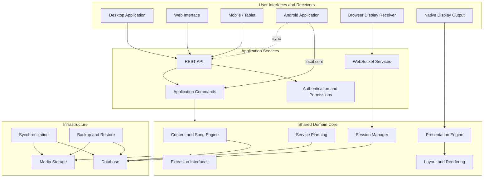

# Technical Architecture Specification
## Offline-First Worship Presentation and Song Management System

**Document status:** Revised architecture  
**Version:** 1.1  
**Project name:** PraiseSuite

---

## Revision Notes (Version 1.1)

This revision incorporates decisions and findings made after the initial proposal:

- **Platform scope:** Portable mode is Windows-only and uses the PortableApps.com Format (Section 15.5). A standalone Android application is added (Section 15.6).
- **Database tiers:** SQLite is used by every client installation (installed desktop, portable, Android). PostgreSQL is used by server deployments only (Section 9).
- **Desktop shell:** Electron is now the preferred candidate and Tauri 2 the alternative, pending prototypes (Sections 2, 15.1, 19).
- **Core portability:** The shared core must be isomorphic (run in Node, browsers, and the Android WebView), and the UI talks to it through a transport abstraction (Sections 3.3, 3.4).
- **Chord storage:** Chords are stored as annotations anchored to character offsets in lyric lines; OpenSong dot notation is an import/export view (Section 8.4).
- **Outputs and casting:** Output adapters are defined, and casting is reassessed (Section 7.5).
- **Backup:** One cross-platform archive format, with the operating system's file picker as the first-release route to cloud storage (Sections 11.3, 11.6, 11.7).
- **Sync:** Merge granularity and mobile synchronization are specified (Sections 10.7, 10.8).
- **Web and Android networking:** Secure-context limits for browser clients and Android cleartext restrictions are documented (Sections 15.6, 15.7).
- Risks, tests, open decisions, and implementation order are updated.

---

## 1. Architecture Overview

### 1.1 Architectural Goal

Build one application platform that can operate as:

- A local desktop application.
- A portable Windows application (PortableApps.com Format).
- A self-hosted server.
- A browser-based application.
- A standalone Android application.
- A LAN presentation server.
- A future hosted service.

These deployments should share the same domain logic, content model, APIs, and frontend wherever practical.

The architecture should avoid creating separate desktop, web, and mobile products with different feature sets.

### 1.2 Proposed High-Level Architecture

The system should be divided into several logical layers:

1. **Presentation layer:** User interfaces and display receivers.
2. **Application layer:** Workflows, commands, permissions, and orchestration.
3. **Domain layer:** Songs, services, arrangements, sessions, and presentation rules.
4. **Infrastructure layer:** Databases, files, media, synchronization, and networking.
5. **Extension layer:** Plugins, integrations, and external providers.

The domain and application layers should not depend directly on a particular desktop framework, browser, or database.

In addition, the domain, application, rendering, and import/export layers must be isomorphic: able to run in Node.js, in browsers, and in the Android WebView (see Section 3.3).

### 1.3 Conceptual Diagram



This diagram represents logical responsibilities, not a requirement that every component run as a separate process.

A local desktop deployment may run the application services in a child process of the desktop shell. A server deployment may separate them into services later if necessary. The Android application runs the shared core inside the application itself, without a server process.

---

## 2. Proposed Technology Direction

These are candidate technologies, not final commitments. They should be validated through small technical prototypes before the project locks them in.

| Area | Candidate | Reason |
|---|---|---|
| Frontend | React + TypeScript | Shared desktop/web interface |
| Styling | Tailwind CSS | Consistent responsive design |
| UI components | Accessible component library | Keyboard and touch usability |
| Desktop shell | Electron (preferred candidate); Tauri 2 (alternative) | Bundled Chromium gives consistent rendering, multi-display control, video, and PDF output on every OS, and the TypeScript core runs natively. Tauri 2 is smaller but relies on each OS's system webview and needs a Node sidecar or a Rust backend |
| Server runtime | Node.js + TypeScript | Shared language and ecosystem |
| Client database | SQLite (installed desktop, portable, and Android) | Embedded, portable, offline-friendly; one schema on every client |
| Server database | PostgreSQL (server deployments only) | Multi-user server workloads; clients never connect to it directly |
| API | REST | Stable integration interface |
| Live communication | WebSockets | Presentation and session updates |
| Deployment | Docker Compose | Self-hosted installation |
| Web / PWA | Responsive PWA | Primary client for self-hosted and hosted instances served over HTTPS |
| Android | Capacitor wrapper around the shared UI, plus small native (Kotlin) plugins | Reuses the React frontend; plugins cover secondary displays, document access, keep-awake, and network discovery |
| Media | Filesystem/object storage abstraction | Keep large files out of relational database |
| Source editor | CodeMirror 6 | Text editing with custom syntax highlighting for OpenSong-style notation |
| API contracts | Zod schemas with generated OpenAPI | One source of truth for validation and documentation |
| Search | SQLite FTS5 (clients); PostgreSQL full-text search (server) | Fast song search and duplicate detection |
| Print / PDF | Chromium-based rendering of the shared HTML/CSS layout | One layout engine for screen, print, and PDF |
| Windows portable packaging | PortableApps.com Format with the PortableApps.com Launcher and Installer | Standard layout, upgrades that preserve user data, runs standalone or from the platform menu |

A key architectural rule is that the domain model must not be tied to these specific choices.

---

## 3. Shared Application Core

### 3.1 Core Responsibilities

The shared core should own:

- Song data and editing rules.
- Chord parsing and transposition.
- Song arrangements.
- Service planning.
- Presentation sequencing.
- Musical position tracking.
- Output rendering rules.
- Session state.
- Permission checks.
- Import/export operations.
- Synchronization semantics.

The frontend should not independently implement these rules.

For example, chord transposition should be performed by shared domain logic rather than separate implementations in the editor, print renderer, and musician display.

### 3.2 Suggested Package Structure

```text
packages/
  domain/
    songs/
    chords/
    arrangements/
    services/
    presentation/
    sessions/
    permissions/

  application/
    commands/
    queries/
    workflows/

  rendering/
    lyrics/
    chord-sheets/
    print/
    display/

  importers/
    opensong/
    openlyrics/

  exporters/
    opensong/
    openlyrics/

  sync/
    protocol/
    engine/
    conflict-resolution/

  api/
    contracts/
    client/
      remote/        (HTTP and WebSocket transport)
      local/         (in-process transport, used by Android)

  plugins/
    contracts/
    runtime/

apps/
  desktop/
  server/
  web/
  receiver/
  android/

infrastructure/
  database/
  media/
  backup/
  networking/
  packaging/
    portableapps/
    docker/

```

This is a logical organization. The implementation may combine packages initially to avoid unnecessary complexity.

### 3.3 Portability Constraints on the Core

The shared core runs in several environments: Node.js (server and desktop), browsers (web app, PWA, receivers), and the Android WebView. The domain, application, rendering, importer, exporter, chord, and synchronization-logic packages must therefore:

- Avoid Node-only APIs (file system, path handling, Buffer assumptions, child processes). Anything environmental, such as storage, files, networking, the clock, random identifiers, and cryptography, is accessed through injected interfaces.
- Use libraries that work in browsers for XML parsing, ZIP handling, and hashing.
- Keep persistence behind repository interfaces so the same logic runs against SQLite on clients and PostgreSQL on the server.
- Be tested in both Node and a browser-like environment.

Platform-specific code belongs in the infrastructure and app packages.

### 3.4 Client-Core Transport

The user interface talks to the core only through the command and query contracts in the application layer, never directly to a database or the network. Two transports implement the same contract:

- **Remote transport:** HTTP and WebSocket against a server (self-hosted, hosted, or the local desktop server).
- **Local transport:** direct in-process calls to the core (Android standalone mode).

On desktop, the shell starts the application server as a child process and the interface uses the remote transport over localhost. Desktop, LAN, and web clients therefore share one code path, and projector windows keep showing their last content even if the server process fails.

On Android there is no server process, so the local transport is used. The Android application can also use the remote transport to control a session hosted elsewhere or to synchronize with a server.

---

## 4. Data Model

### 4.1 Design Principles

The internal data model should be independent of OpenSong's file format.

OpenSong should be treated as an import/export format adapter.

Important principles:

- Stable identifiers.
- Explicit relationships.
- Revision tracking.
- Separation of reusable content from service-specific usage.
- Separation of content from presentation state.
- Separation of original musical data from instrument-specific presentation.
- No dependence on filenames as primary identifiers.

### 4.2 Core Entities

The following is an initial conceptual model.

#### Organization
Represents an organization or church.

Potential fields:
- id
- name
- settings
- created_at

Organization ownership should be considered from the beginning, even if the first release has only one organization per installation.

#### User
Represents a person who can authenticate.

Potential fields:
- id
- username
- display_name
- authentication data
- status

#### Role and Permission
Defines what a user or guest can do.

Permissions should be scoped where appropriate, including administrative, library, service, and session permissions.

#### Song
Represents a reusable musical work.

Potential fields:
- id
- title
- authors
- copyright
- ccli_number
- default_key
- tempo
- time_signature
- metadata
- revision

#### SongSection
Represents a reusable section of a song.

Examples:
- Verse 1
- Verse 2
- Chorus
- Bridge
- Tag

Potential fields:
- id
- song_id
- section_type
- label
- content
- ordering
- metadata

#### SongArrangement
Represents a particular arrangement of a song.

Potential fields:
- id
- song_id
- name
- key
- tempo
- time_signature
- arrangement_notes
- revision

An arrangement references sections and defines their order and repetition.

#### ArrangementSection
Represents a section occurrence in an arrangement.

It should reference the reusable SongSection while having its own position and arrangement-specific properties.

This allows a chorus to appear more than once without duplicating the actual lyrics.

#### InstrumentProfile
Defines a musician's preferred display and musical configuration.

Potential fields:
- id
- name
- instrument_type
- transposition
- capo
- preferred_chord_voicings
- display_preferences

#### Service
Represents a planned event or service.

Potential fields:
- id
- name
- date
- description
- metadata

#### ServiceItem
Represents an individual item in a service.

Examples:
- Song.
- Scripture passage.
- Video.
- Announcement.
- Presentation segment.

It should reference reusable content while retaining service-specific ordering and configuration.

#### PresentationSession
Represents a live execution of a service.

Potential fields:
- id
- service_id
- session_name
- status
- current_position
- created_at
- last_activity
- recovery_state

A session must be independent of the Service record.

#### PresentationOutput
Represents a display or output connected to a session.

Potential fields:
- id
- session_id
- output_type
- configuration
- follow_mode
- current_position
- device_id

#### Device
Represents a connected device.

Potential fields:
- id
- name
- device_type
- last_seen
- capabilities

#### MediaAsset
Represents an image, video, audio file, or other resource.

Potential fields:
- id
- media_type
- storage_key
- original_filename
- size
- checksum
- metadata

#### Revision
Represents a version of an editable object.

Revision data should include:
- object_id
- revision_id
- parent_revision_id
- author/device
- change metadata
- creation time

The actual implementation may use a unified revision table or per-entity revision tracking.

---

## 5. Musical Structure and Presentation Synchronization

This is one of the most important architectural decisions.

### 5.1 Do Not Synchronize by Slide Number

The projector and musician display may present different amounts of information.

For example:

- Projector: two lyric lines per slide.
- Guitar: complete song with chords.
- Drums: current section and next transition.
- Piano: complete song with lyrics and chords.

Therefore, synchronizing displays by slide number is fundamentally incorrect.

### 5.2 Shared Musical Position

The presentation engine should track a shared musical position.

A conceptual position could contain:

```text
session_id
service_item_id
song_id
arrangement_id
section_id
section_instance_id
position_within_section
```

The exact fields will depend on the final model.

### 5.3 Section Identity vs. Section Instance

Two identifiers are necessary.

**Section ID:** Identifies the reusable section in the song.

**Section instance ID:** Identifies a particular occurrence of that section in an arrangement or live service.

For example, a song may use the same chorus three times.

All three occurrences reference the same reusable Chorus section, but each receives a unique section-instance ID.

This makes it possible to synchronize musicians correctly even when a section repeats.

### 5.4 Presentation Mapping

The presentation engine should map musical positions to output-specific content.

A projector may divide a section into several slides.

A musician display may render the whole section.

The output renderer determines how much content to display, while the session manager maintains the shared musical position.

### 5.5 Independent Navigation

Every output should have an explicit navigation mode.

Possible modes:

- Follow session.
- Independent.
- Hybrid.

Manual navigation on a musician output must never change the main presentation position unless the user explicitly changes the session through an authorized control.

Hybrid mode should track whether the device is temporarily overridden and optionally return to follow mode after a configurable interval.

---

## 6. Presentation Session Architecture

### 6.1 Session Lifecycle

A session should have a defined lifecycle:

1. Create session from a service.
2. Load required content and media.
3. Initialize presentation state.
4. Start session.
5. Accept connected devices.
6. Process authorized control actions.
7. Update presentation position.
8. Broadcast state changes.
9. Handle disconnects and reconnects.
10. End or suspend the session.
11. Persist recovery state.

### 6.2 Multiple Sessions

The session manager must support multiple independent sessions simultaneously.

A session should not be identified only by a single global current-service variable.

Every live command, output, device subscription, and presentation update must be associated with a session identifier.

### 6.3 Session State

Session state should include:

- Current service item.
- Current song and arrangement.
- Current musical position.
- Current presentation position.
- Active outputs.
- Connected devices.
- Control ownership.
- Session permissions.
- Recovery information.

The active presentation state should primarily be maintained in memory for responsiveness, with important state changes persisted as appropriate.

### 6.4 Device Connections

Devices should connect using a session-scoped authorization mechanism.

Potential methods:

- QR code containing a short-lived session URL.
- Short join code.
- Direct URL.
- LAN discovery.

The connection workflow should not expose the entire library to a guest device.

### 6.5 Reconnection

The system should handle:

- Wi-Fi interruption.
- Browser refresh.
- Device sleep.
- Application restart.
- Temporary server unavailability.

A reconnecting device should identify its session and restore its appropriate output configuration and follow behavior.

---

## 7. Rendering Architecture

### 7.1 Shared Rendering Engine

A shared rendering engine should produce the representations needed by:

- Projector output.
- Confidence display.
- Musician display.
- Digital songbook.
- Print chord sheets.
- PDF exports.

The same underlying song and arrangement data should drive every representation.

### 7.2 Layout Abstraction

Rendering should be separate from content.

A song should not need a different data representation to print than it does to display on a projector.

Instead, renderers should apply different layout policies.

Examples:

- Projector renderer: large text, limited lines, high contrast.
- Musician renderer: lyrics and chords, section navigation.
- Print renderer: page-aware layout, margins, columns.
- Digital songbook renderer: responsive page layout and interactive navigation.

### 7.3 Print and Digital Consistency

The digital songbook and print/PDF outputs should share a layout engine or a common layout specification.

This should prevent users from maintaining separate formatting rules for printed and digital charts.

The recommended approach is to express layouts in HTML and CSS and generate PDFs with Chromium's print-to-PDF capability (built into Electron, or a headless Chromium on the server). A dedicated typesetting engine remains an alternative if pagination control proves insufficient (see Section 19).

### 7.4 Media Rendering

Images, video, and audio should be handled through media abstractions.

Presentation content should reference media assets by stable IDs rather than depending directly on absolute filesystem paths.

### 7.5 Output Adapters

Each presentation output is driven by an adapter that receives the session's musical position and the output's rendering policy and shows the result on a physical or virtual display. Adapters share the renderer; only the display mechanism differs.

| Adapter | Mechanism | Works offline | Notes |
|---|---|---|---|
| Desktop window | Borderless fullscreen window per monitor | Yes | Primary projector, confidence, and stage output |
| Browser receiver | Web page connected by WebSocket | Yes (LAN) | Works on any modern browser, including a dedicated kiosk device |
| Android secondary display | Android Presentation API hosting a second WebView on a display the OS exposes (HDMI or USB-C, Miracast or wireless display, mirrored cast devices) | Yes | Requires a small native plugin; behavior varies by device |
| Android TV / Fire TV receiver | Receiver app connecting to a session server | Yes (LAN) | Avoids casting protocols; later phase |
| Google Cast custom receiver | Receiver web app registered with Google and served over HTTPS | Not in practice | Optional adapter for online-capable sites |
| Roku, Samsung (Tizen), others | Platform-specific applications | Varies | Deferred; assess individually |

Notes, to be confirmed by testing on target hardware:

- Google Cast custom receivers must be registered with Google, and the published receiver URL must use HTTPS. The cast device therefore needs a publicly trusted certificate and, in practice, internet access to load the receiver. The default Cast media receiver cannot show custom content.
- Miracast and screen mirroring are operating-system display features, not application-level protocols. The application sees them only as another display when the OS exposes them that way.
- An adapter interface should cover registration, position updates, disconnect and reconnect handling, and a description of capabilities (resolution, video, audio).

---

## 8. Chord Engine

### 8.1 Responsibilities

The chord engine should handle:

- Parsing chord notation.
- Recognizing chord roots and qualities.
- Transposition.
- Alternate bass notes.
- Slash chords.
- Enharmonic spelling.
- Capo-aware display.
- Custom chord definitions.
- Chord diagrams and voicing metadata.

### 8.2 Canonical Chord Representation

The internal chord representation should be structured rather than treating every chord as an arbitrary text string.

A conceptual chord might contain:

```text
root
quality
extensions
alterations
bass_note
display_name
voicing
```

Custom names and unsupported notation should be preserved rather than discarded.

### 8.3 OpenSong Source Compatibility

The OpenSong parser should translate source notation into the canonical model.

The exporter should translate canonical content back into the supported OpenSong representation.

The source editor should preserve compatibility with the original notation where practical.

### 8.4 Canonical Lyric and Chord Storage

A song section's content is stored as a sequence of lines. Each line holds its lyric text and an ordered list of chord annotations. Each annotation has a character offset into the lyric text and a structured chord (Section 8.2).

OpenSong dot notation, in which chord lines sit above lyric lines and are aligned by column, is an import and export representation:

- Import converts column positions into character offsets.
- Export regenerates aligned lines.
- The source editor serializes to and from the canonical form.

Anchoring chords to offsets lets lyric edits move chords predictably and lets the visual editor, source editor, projector, musician display, and print renderer all work from the same data. The conversion should be validated against a real OpenSong library, including songs with irregular spacing.

---

## 9. Storage Architecture

### 9.1 Database Abstraction

The application should use a database access layer rather than embedding database-specific SQL throughout the domain logic.

Proposed initial database support:

- SQLite for every client installation: installed desktop (Windows, macOS, Linux), Windows portable, and Android. These are single-user installations and never require a database server.
- PostgreSQL for server deployments only (self-hosted and hosted). Clients never connect to the server database directly. They use the API and the synchronization protocol, so the database dialect is invisible to them.
- Optionally, SQLite as a supported database for very small self-hosted servers (see Section 19, item 9).

The architecture should avoid assuming that SQLite and PostgreSQL behave identically in every edge case.

The repository layer therefore has two implementations, but only server code must support both. Client code targets SQLite only, which keeps the client schema, queries, and migrations simple.

### 9.2 SQLite Usage

SQLite is appropriate for local deployments because it:

- Requires no separate database service.
- Is portable.
- Works offline.
- Supports transactional updates.
- Is well suited to a single application instance.

Important considerations:

- Do not open a SQLite database directly from multiple computers over a network share.
- LAN clients must access it through the application API.
- WAL mode requires sidecar files and shared-memory behavior that may not be appropriate on all removable or network filesystems.
- Test locking and durability behavior on supported filesystems.
- Use conservative database settings for portable deployments where compatibility is more important than maximum throughput.
- On Windows portable installs on removable drives, use the rollback journal (journal_mode=DELETE) with full synchronous writes rather than WAL, take periodic consistent snapshots, and use a single-writer lock file so two computers cannot open the same database at once.
- On Android, access SQLite through a native SQLite plugin (or SQLite compiled to WebAssembly with persistent storage) behind the same repository interface.
- Use FTS5 for full-text song search.

### 9.3 PostgreSQL

PostgreSQL is used by server deployments only. It should be available for deployments that need:

- More concurrent database users.
- Larger installations.
- Centralized server operation.
- Hosted service infrastructure.

The domain model and repository interfaces should remain consistent across database backends.

### 9.4 Media Storage

Media should be stored as ordinary files or through a storage abstraction, not embedded as large binary objects in the database.

The database should store metadata and stable storage references.

Possible storage backends:

- Local filesystem.
- External filesystem.
- Network-accessible object storage.
- S3-compatible storage.

### 9.5 Portable Directory Layout

Portable mode is a Windows deliverable packaged in the PortableApps.com Format (see Section 15.5 for the full packaging design). An illustrative layout:

```text
WorshipPortable/                    (name to be determined)
  WorshipPortable.exe               PortableApps.com Launcher
  App/
    AppInfo/
      appinfo.ini
      appicon files
      Launcher/                     launcher configuration
    Worship/                        the application (shell, server, frontend)
    DefaultData/                    first-run seed data
  Data/
    worship.db
    media/
    backgrounds/
    attachments/
    config/
    electron/                       shell profile, caches, logs
    backups/
  Other/
    Help/
    Source/
```

The App directory is replaceable during upgrades. The Data directory holds everything the user owns and is preserved. The exact layout within Data should be configurable, and the application should detect portable mode through the launcher's configuration or an explicit marker.

### 9.6 Portable Storage Safety

Portable mode should:

- Keep application data on the removable drive.
- Avoid unnecessary host-machine writes, including the shell's profile, caches, logs, crash dumps, and temporary files.
- Use safe database shutdown behavior, and close the database promptly when the PortableApps.com Platform closes the application or the drive is ejected.
- Avoid relying on filesystem-specific features. NTFS and exFAT are supported; FAT32 is discouraged because of its 4 GB file-size limit.
- Warn about filesystems and drives with unreliable locking or durability.
- Provide a safe-eject workflow where practical.
- Avoid automatic updates that could interrupt a running portable installation.
- Reference media by storage key or relative path, because the drive letter changes between computers.

An optional host-cache mode may be introduced later, but it should be explicitly enabled.

### 9.7 Search and Duplicate Detection

- Song search uses SQLite FTS5 on clients and PostgreSQL full-text search on the server.
- Duplicate detection during import combines identifiers, normalized title and author, CCLI numbers, and a normalized-lyrics comparison. Normalization removes punctuation, case, spacing, and chord notation, and similarity can be estimated with hashed word shingles.
- The same detection code runs in every environment (Section 3.3).

---

## 10. Synchronization Architecture

### 10.1 Synchronization Is Not Backup

Synchronization keeps installations aligned.

Backup provides an independent recovery copy.

They must have separate implementations, configuration, and user-facing workflows.

### 10.2 Stable Object Identity

Every synchronizable object must have a stable ID.

The ID must remain unchanged when the object is edited, moved, renamed, or exported and re-imported where identity can be established.

### 10.3 Revision Tracking

Each editable object should track its revision history.

The synchronization engine must be able to determine:

- Which version a device has.
- Which changes are new.
- Whether two devices changed the same object.
- Whether a change can be merged safely.

Timestamps may be useful metadata, but must not be the sole conflict-resolution mechanism.

### 10.4 Conflict Resolution

Preferred behavior:

1. Automatically merge independent changes where safe.
2. Detect conflicting changes to the same logical content.
3. Preserve both versions.
4. Present a clear resolution workflow.
5. Never silently overwrite user content when the correct result is uncertain.

### 10.5 Incremental Synchronization

The sync engine should transfer only changed objects and required media.

It should support:

- Interrupted transfers.
- Retry.
- Resume.
- Checksum verification.
- Selective synchronization.
- Initial full synchronization.
- Subsequent incremental synchronization.

### 10.6 Offline Workflow

A laptop should be able to synchronize selected services and library content from a central server before an event.

It should then operate independently.

After the event, changes can synchronize back to the central installation.

The application should make unsynchronized changes visible to the user.

### 10.7 Merge Granularity

Because songs are composed of separate SongSection, arrangement, and metadata objects, most independent edits (for example, one person editing a verse and another editing the arrangement) can be merged automatically at the object or field level. Conflicting edits to the same section are preserved as two versions for the user to resolve.

Conflict-free replicated data types (CRDTs) are not planned unless real-time collaborative text editing becomes a requirement.

### 10.8 Mobile Synchronization

The Android application is another replica running the same protocol as the desktop:

- Synchronization is user-initiated by default. Background synchronization is optional and requires native scheduling support.
- Conflict resolution on a phone should be simple: show both versions and let the user choose one or keep both.
- Media transfer is resumable and checksum-verified, with an option to use Wi-Fi only.
- Authentication tokens are stored in platform secure storage.
- On plain-HTTP local servers, REST calls may need to go through native HTTP to avoid browser cross-origin restrictions (see Section 15.6).

---

## 11. Backup Architecture

### 11.1 Backup Scope

A complete backup should include:

- Database.
- Media.
- Attachments.
- Configuration.
- Relevant plugin configuration.
- Optional plugin files.
- Required metadata for restoration.

### 11.2 Consistency

The backup engine must create database-consistent snapshots.

Copying a live SQLite database file without considering its journaling mode is not sufficient.

### 11.3 Backup Destinations

Implement a destination abstraction. Destinations are introduced in stages.

Initial destinations:

- Local directories and external drives.
- Network shares.
- Another application server.
- The operating system's file picker, for "Save backup to..." and "Restore from file...". On Android this reaches Google Drive, OneDrive, Dropbox, and other providers whose apps are installed.
- Folders synchronized by a provider's own desktop client, which appear as local directories.

Later destinations:

- WebDAV.
- S3-compatible storage.
- Direct integrations with Google Drive, OneDrive, and Dropbox.

Provider integrations should be added incrementally. See Section 11.7 for why the file picker comes first.

### 11.4 Encryption

Cloud-bound backups should support client-side encryption.

The user should control the encryption key and receive clear warnings about the consequences of losing it.

Because a backup saved through the file picker can land with any provider, the backup flow should offer encryption every time a backup is saved. Use authenticated encryption from a well-reviewed library rather than a custom scheme, and process large archives in chunks so they can be streamed.

### 11.5 Restore

Restore workflows should support:

- Full installation restore.
- Selective content restore.
- Individual song restore.
- Media restore.
- Restore to a new installation.

Backups should be testable and verifiable.

### 11.6 Backup Archive Format

All platforms use one archive format so that a backup from any installation can be restored to any other (for example, from Android to a desktop installation).

The archive contains:

- A manifest with the archive format version, application version, database schema version, creation time, source platform and device, and a checksum for every file.
- A consistent database snapshot produced with SQLite's backup or VACUUM INTO facilities (never a raw copy of a live database file).
- Media and attachments, optionally. Android defaults to excluding large video files.
- Configuration and relevant plugin configuration.

Rules:

- Checksums are verified after writing and again before restoring.
- Restore validates the format version, migrates older schemas, and refuses archives with a newer schema than the application understands.
- The database snapshot can be opened read-only to support restoring individual songs.
- Large media is streamed rather than loaded into memory.
- Encryption, when enabled, applies to the whole archive.

### 11.7 Cloud Storage Through the File Picker

For Google Drive, OneDrive, Dropbox, and similar providers, the first-release approach is the operating system's document picker:

- Saving a backup opens the system "create document" dialog, and restoring opens the "open document" dialog.
- The product needs no provider sign-in, developer-account registration, provider SDK, or review process, and it works with any provider that integrates with the picker.
- Limitations: it is manual, so there are no unattended scheduled cloud backups from Android, and folder-level support varies by provider.

Direct provider integrations are deferred. If added later, they should use sign-in in the system browser (not an embedded WebView) and the narrowest available permissions, such as an application-specific folder, because broad file-access permissions trigger heavier provider review.

---

## 12. API and Real-Time Communication

### 12.1 REST API

The REST API should handle conventional application operations:

- Song management.
- Service management.
- Media management.
- Import and export.
- User and permission management.
- Session creation.
- Session administration.
- Device registration.
- Synchronization operations.

The API should be versioned.

### 12.2 WebSockets

WebSockets should handle real-time events such as:

- Presentation position changes.
- Session state updates.
- Device connection status.
- Remote control commands.
- Output state changes.
- Control ownership changes.

### 12.3 Session Scoping

All live presentation messages must be associated with a session.

A device connected to one session must not receive updates from unrelated sessions.

### 12.4 API Documentation

The API should be documented from the beginning.

OpenAPI should be evaluated for REST API documentation and client generation.

The API should be suitable for external integrations and alternative clients.

### 12.5 Version Compatibility

Installed clients, notably the Android application, which bundles its own interface, can be older than the server they connect to. The API therefore needs an explicit compatibility policy:

- The server supports at least the previous API version.
- Clients report their version when connecting.
- The server can respond with a clear "update required" message.
- The synchronization protocol version is negotiated at connection time.

---

## 13. Authentication and Permissions

### 13.1 Authentication

The application should support local accounts initially.

The authentication architecture should allow future external identity providers.

On Android, access tokens are stored in the platform's secure storage (Keystore-backed), not in web storage.

### 13.2 Authorization

Permissions should be enforced by the server or application core, not merely hidden in the interface.

Potential permission categories:

- Application administration.
- Library viewing.
- Library editing.
- Service planning.
- Presentation control.
- Session management.
- Device joining.
- Plugin management.

### 13.3 Guest Session Access

Guest access should be configurable globally and potentially per session.

A guest token should be:

- Limited in scope.
- Revocable.
- Optionally time-limited.
- Associated with a specific session.
- Insufficient to access administrative or library functions unless separately authorized.

### 13.4 Control Ownership

Presentation control should be explicitly authorized.

The session manager should validate each control action against the user's permissions and current control policy.

---

## 14. Extension Architecture

### 14.1 Plugin Interfaces

The plugin system should define stable contracts for:

- Content providers.
- Importers.
- Exporters.
- Presentation outputs.
- Media providers.
- Scripture providers.
- External integrations.
- Planning tools.

### 14.2 Plugin Types

The system should distinguish between:

**Trusted native plugins**

Can integrate closely with the application but require explicit installation and trust.

**Sandboxed web extensions**

Have limited capabilities and communicate through approved interfaces.

**External integrations**

Connect through the documented API and receive only the permissions granted to them.

For the first release, extension interfaces (importers, exporters, and providers) are defined as typed contracts and loaded as trusted in-process code. Sandboxing for third-party plugins (sandboxed frames communicating by message passing for interface extensions, and isolated workers or WebAssembly for server-side code) is deferred until third-party plugins are actually supported.

### 14.3 Plugin Manifest

A plugin manifest should declare:

- Plugin ID.
- Name and version.
- Supported application versions.
- Required permissions.
- Extension points.
- Dependencies.
- Configuration schema.
- Update source.

### 14.4 Plugin Lifecycle

The application should support:

- Installation.
- Enable/disable.
- Configuration.
- Version compatibility checks.
- Updates.
- Removal.
- Error reporting.

A public plugin marketplace is a later feature, not a prerequisite for the core system.

---

## 15. Deployment Architecture

### 15.1 Desktop

The desktop application should package:

- Shared frontend.
- Local application services.
- Local database support.
- Media access.
- Display integration.
- Optional LAN server.

Installed builds are provided for Windows, macOS, and Linux and always use SQLite. Windows portable distribution is covered in Section 15.5.

Electron is the preferred desktop shell. Its bundled Chromium provides consistent rendering, mature multi-display control, reliable video playback, and built-in PDF output on every operating system, and the TypeScript core runs natively in its Node environment. The costs are a larger download and higher memory use, which matter little for presentation computers.

Tauri 2 remains an alternative. It is smaller, but it uses each operating system's system webview (with known differences in video and multi-window behavior, particularly on Linux) and requires either a bundled Node sidecar or a Rust backend, which would split the shared core.

In either case the shell should stay thin, and the application server runs as a child process that the interface reaches through the local API (Section 3.4). The actual framework choice should follow a working prototype (Section 19).

### 15.2 Server

The server should expose the same application API and web frontend.

A Docker Compose deployment may contain:

```text
application
database
media storage
optional reverse proxy
```

The application should not require every component to run as a separate container if a simpler deployment is sufficient.

### 15.3 Local LAN Mode

A desktop installation should be able to expose its API and web interface on the local network.

Security considerations:

- Bind to LAN interfaces only when explicitly enabled.
- Display the listening address.
- Provide a clear way to disable LAN access.
- Require authentication for administrative operations.
- Apply guest-session permissions independently.

### 15.4 Hosted Deployment

A hosted deployment should use the same application core and API.

The architecture should support multiple organizations, but full tenant management can be implemented later.

### 15.5 Windows Portable Distribution (PortableApps.com Format)

Portable operation is a Windows-only deliverable (64-bit Windows 10 and 11), packaged in the PortableApps.com Format. At the time of writing the published format specification is version 3.9; check the current version before release.

Package structure:

- A main folder containing App, Data, and Other directories and a launcher executable, built with the PortableApps.com Launcher.
- App/AppInfo holds appinfo.ini, the icons, and the launcher configuration.
- App/DefaultData holds seed data copied into Data on first run.
- The package is distributed as a .paf.exe installer built with the PortableApps.com Installer. By default the installer replaces App and Other and preserves Data.
- Because the application is released by its own authors rather than by PortableApps.com, the AppID follows the format's rule for third-party apps (the app name followed by the publisher's domain).

Packaging rules:

- Do not use a single-file self-extracting "portable" build. Such builds unpack into the host's temp folder on every launch. Ship the unpacked application folder, with application code bundled into an archive to reduce small-file reads on slow flash storage.
- The launcher passes the data location to the application (by environment variable or argument). Before startup, the application redirects every shell path (profile, session data, caches, logs, crash dumps) into Data, and minimizes temporary-file use.
- No registry entries and no writes to the host's AppData folder.
- No in-application auto-update. Updates arrive as new .paf.exe packages, through the PortableApps.com Platform updater if the app is listed in the official directory, or manually otherwise.

Upgrade safety:

- Because upgrades replace App and keep Data, the application migrates data on the first launch of a new version.
- Before migrating, it creates an automatic backup in Data/backups.
- It refuses to open data whose schema is newer than it understands, which protects against accidental downgrades.

Runtime behavior:

- Stored content uses storage keys and relative paths only, because the drive letter changes between computers.
- A single-writer lock file (with stale-lock detection) prevents two computers from opening the same data at once, and the application explains who holds the lock.
- The application closes the database promptly when the PortableApps.com Platform closes it or the drive is ejected.
- LAN mode on a portable installation triggers a Windows firewall prompt that needs administrator approval. The application detects this and explains it.
- Sign binaries where possible to reduce SmartScreen and antivirus friction.
- Listing in the official PortableApps.com directory is optional. It involves their review process and should be decided separately from the technical work. The package works standalone without a listing.

### 15.6 Android Application

The Android application is a client that can also run standalone. It bundles the shared React interface in a Capacitor wrapper and runs the shared core inside the WebView with SQLite behind a native plugin (Section 3.4, local transport).

Native plugins (Kotlin) provide:

- **Secondary display:** listens for displays the OS exposes and opens an Android Presentation hosting a second WebView, with session state relayed from the main WebView. Handles hot-plug and disconnects.
- **Document access:** system document picker for zip import and for backup save and restore, plus optional folder selection through the Storage Access Framework.
- **Device features:** keep-awake and immersive full-screen, QR scanning, and secure token storage.
- **Network discovery:** discovery of servers and LAN hosts through the platform's network service discovery.
- **Session hosting (later phase):** an embedded HTTP and WebSocket server running as a foreground service only while a session is active.

Importing OpenSong data:

- Zip import is the first route. Folder import through the Storage Access Framework follows, since reading thousands of files through it is slow.
- Content is imported once into SQLite, with media copied into app-private storage, and large libraries import in the background with progress.

Networking:

- Android blocks plain-HTTP (cleartext) traffic by default, but self-hosted and desktop LAN servers are usually plain HTTP. The application must opt in explicitly through its network security configuration.
- The WebView origin for bundled content is a local origin. By default it is HTTPS, and requests from it to HTTP endpoints are blocked as mixed content. Configure the bundled origin and the cleartext policy so that REST and WebSocket (ws://) connections to LAN servers work, and consider native HTTP for REST calls to avoid cross-origin restrictions. WebSocket behavior must be prototyped specifically.
- Bundle the interface in the app. Do not rely on Capacitor's remote-URL mode, which its documentation says is not intended for production.
- Because the interface is bundled, the API compatibility policy (Section 12.5) is essential.

Lifecycle and distribution:

- Persist session state so that suspension, interruption, or process death can be recovered from.
- Distribution options are Google Play, direct APK download, and optionally F-Droid. Check Google Play's current developer-account and testing requirements before planning a release date.
- iOS and iPadOS use the web app. A native iOS application is not planned, though the same wrapper could target iOS later.
- An Android TV and Fire TV variant (launcher support and remote-control navigation) can serve as a receiver for televisions.

### 15.7 Web App (PWA) and Secure Contexts

The installable web app is intended for self-hosted and hosted instances served over HTTPS (for example, behind a reverse proxy with automatic certificates, or over a private network overlay).

Service workers, the screen wake lock, and several other browser features require a secure context. Plain-HTTP addresses on a local network (such as http://192.168.x.x) do not qualify, although localhost does. On LAN-only installations, browser clients therefore lose offline caching and keep-awake. The options are:

- Local HTTPS with locally trusted certificates (difficult for non-technical users).
- A domain with a wildcard certificate that resolves to private addresses (needs internet access at least for issuance and renewal).
- Accepting the limits and using the Android application, whose bundled origin is a local origin and which has native keep-awake.

The product should document these limits honestly and must not promise offline PWA behavior on plain-HTTP LANs. Safari on iOS has its own storage and background limits, which should be tested.

---

## 16. Security and Reliability

### 16.1 General Security

- Secure authentication.
- Permission enforcement in application services.
- Session-scoped access tokens.
- Secure secret storage.
- Restricted plugin permissions.
- Validated imports.
- Safe handling of uploaded media.
- No unnecessary background services.

### 16.2 Portable Application Security

Portable executables may be treated cautiously by endpoint security products, particularly when unsigned or unfamiliar.

Mitigations should include:

- Signed binaries where possible.
- Predictable installation and data locations.
- No unnecessary execution from temporary directories.
- No silent background service installation.
- Explicit update behavior.
- Clear documentation of required network access.

No design can guarantee that every endpoint security product will permit execution from removable storage.

Additional Windows considerations: unsigned downloads trigger SmartScreen warnings; files extracted from a downloaded archive carry a "mark of the web"; some organizations block execution from removable drives by policy (for example, application allow-listing), which the application cannot override; and listening on the network triggers a firewall prompt that needs administrator approval.

### 16.3 Presentation Reliability

Presentation should be resilient to:

- Internet loss.
- Temporary LAN interruption.
- Database-server unavailability after content is loaded.
- Device disconnects.
- Browser refreshes.
- Application restarts.

Content and media required for a live session should be prepared or cached locally before presentation.

### 16.4 Observability

The application should provide useful logs for:

- Import errors.
- Synchronization failures.
- Database issues.
- Plugin errors.
- Session connection problems.
- Presentation output failures.

Logs should be accessible without requiring users to understand internal implementation details.

### 16.5 Android Security

- Allow cleartext network access only when the user enables it for a specific local-network server.
- Store tokens in Keystore-backed secure storage.
- If direct cloud-provider integrations are added, sign in through the system browser, not an embedded WebView.
- Harden the WebView: disable file access that is not needed, do not load remote content into a WebView that has the native bridge, and do not ship development-only settings (such as remote-URL mode or cleartext defaults) in release builds.
- Request only the permissions needed (camera for QR scanning is optional). Avoid broad storage permissions.

---

## 17. Testing Strategy

### 17.1 Domain Tests

Test:

- Song parsing.
- Chord parsing.
- Transposition.
- Arrangement handling.
- Section identity.
- Repeated section instances.
- Presentation position mapping.
- Permission evaluation.
- Conflict resolution.

### 17.2 Import/Export Tests

Maintain representative OpenSong libraries as test fixtures.

Test:

- Individual songs.
- Large libraries.
- Chord placement.
- Metadata.
- Media references.
- Sets.
- Duplicate handling.
- Round-trip export/import where supported.

### 17.3 Presentation Tests

Test:

- Multiple simultaneous sessions.
- Multiple outputs per session.
- Independent musician navigation.
- Follow and hybrid modes.
- Repeated song sections.
- Device reconnects.
- Presenter control handoff.

### 17.4 Deployment Tests

Test:

- Windows desktop.
- macOS desktop.
- Linux desktop.
- Windows portable (PortableApps.com Format) on removable storage.
- Android standalone application.
- SQLite local deployment.
- PostgreSQL server deployment.
- Docker Compose.
- LAN access.
- Offline operation.

### 17.5 Reliability Tests

Test:

- Sudden network loss.
- Application crash.
- Database interruption.
- USB removal scenarios.
- Interrupted synchronization.
- Interrupted backup.
- Recovery from a previous backup.

### 17.6 Android Tests

Test:

- Secondary display output over HDMI or USB-C, Miracast or wireless display, and screen-mirrored cast devices, on the target phones and tablets.
- Display hot-plug, disconnect, and reconnect during a session.
- WebView video backgrounds and automatic text scaling on the external display.
- Zip import of a large OpenSong library, and folder import through the document picker.
- REST and WebSocket connections to a plain-HTTP LAN server, including after the app is suspended.
- Backup save and restore through the file picker, including restoring an Android backup on desktop.
- Synchronization on request, including interrupted transfers.
- App suspension and process death during a live session.

### 17.7 PortableApps.com Package Tests

Test:

- A clean Windows virtual machine with a file and registry monitor, to confirm no writes to AppData, temp folders, or the registry.
- Running as a standard (non-administrator) user.
- Moving the drive between computers, including a different drive letter.
- Upgrade (App replaced, Data preserved), automatic pre-migration backup, and refusal to open data from a newer version.
- Closing and ejecting through the PortableApps.com Platform while a presentation is running.
- Two computers attempting to open the same data.
- FAT32, exFAT, and NTFS drives, and sudden drive removal.

### 17.8 Core Portability Tests

Run the domain, application, importer, chord, and rendering test suites in both Node and a browser-like environment, so that Node-only dependencies cannot creep into the shared core.

---

## 18. Major Architectural Risks

| Risk | Mitigation |
|---|---|
| OpenSong format complexity | Build and test an importer early using a real library |
| Different output formats drifting apart | Use one canonical content model and shared rendering rules |
| Musician/projector synchronization complexity | Design shared musical position and section-instance IDs early |
| Portable database corruption | Test storage behavior and use conservative settings |
| Cross-platform display differences | Prototype native display output early |
| Casting protocol limitations | Evaluate each target independently |
| Plugin security | Define permissions and trust boundaries before third-party plugins |
| Sync conflicts | Design stable IDs and revision tracking before sync implementation |
| Overly broad first release | Keep architecture extensible while delivering a narrow, complete core workflow |
| Desktop shell choice (Electron versus Tauri) | Prototype before committing; keep the shell thin so it can be replaced |
| Core accidentally becomes Node-only, blocking Android and browser use | Enforce the portability rules in Section 3.3 and run tests in a browser-like environment |
| Android external-display behavior varies by device | Test on target hardware early; treat HDMI as the dependable path; provide an on-device preview |
| Google Cast receivers need registration and likely internet access | Treat Cast as an optional adapter; prefer OS-level displays and dedicated receiver devices |
| Plain-HTTP LANs block PWA offline features | Document the limits; provide the Android app; offer optional HTTPS guidance |
| Android cleartext and mixed-content restrictions | Explicit network configuration; prototype REST and WebSocket over HTTP early; bundle the interface |
| Version skew between the bundled Android interface and the server | Versioned API with a compatibility window (Section 12.5) |
| PortableApps.com package writes to the host or breaks on upgrade | Redirect all shell paths; test on a clean VM; preserve Data with migrations and pre-migration backup |
| Android scoped storage complicates library import | Zip import first; folder import through the document picker; import into app storage |

---

## 19. Technical Decisions Still Requiring Validation

The following should be resolved through prototypes or implementation research rather than assumed. Where a current direction exists, it is noted.

1. **Tauri 2 versus Electron.** Direction: Electron, pending a prototype covering multi-monitor fullscreen output, video playback, PDF output, and portable operation.
2. **Node.js packaging for desktop.** With Electron, Node runs inside the shell and server child process. Packaging a Node sidecar matters only if Tauri is chosen.
3. **In-process or service boundary for the core.** Direction: on desktop, the server runs as a child process reached through the local API (remote transport); on Android, the core runs in-process (local transport). See Section 3.4.
4. **SQLite journaling settings per deployment mode.** Direction: rollback journal with full synchronous writes for Windows portable; WAL acceptable for installed desktop and server volumes; Android settings to be tested with the chosen plugin.
5. **Canonical representation of OpenSong chord notation.** Direction: chords anchored by character offset in lyric lines (Section 8.4). Validate against a real library, including irregular spacing.
6. **PDF and print rendering.** Direction: Chromium-based rendering of the shared HTML/CSS layout. A dedicated typesetting engine is the alternative if pagination control is insufficient.
7. **Casting and external displays.** Direction: OS-level secondary displays on Android, dedicated receiver devices, and browser receivers. Google Cast is optional because it requires registration and likely internet access. Roku and Samsung are deferred.
8. **Synchronization protocol and conflict model.** Open. Starting point: per-object revisions with section-level merging (Section 10.7), no CRDTs.
9. **Whether PostgreSQL is mandatory for server deployments** or SQLite is also supported for very small servers. PostgreSQL remains the primary server database either way.
10. **Plugin sandboxing strategy.** Deferred. First-release contracts are trusted in-process code (Section 14).
11. **Native mobile.** Direction: Capacitor-based Android app sharing the web interface; iOS served by the web app.
12. **Browser access on LAN-only networks.** How much HTTPS guidance or tooling to provide, given the secure-context limits (Section 15.7).
13. **Android secondary-display behavior.** WebView video and text scaling on HDMI, Miracast, and mirrored cast displays across the target devices.
14. **Android cleartext and WebSocket configuration.** Which combination of bundled-origin settings and native HTTP works reliably for REST and WebSocket (Section 15.6).
15. **PortableApps.com distribution.** Self-distributed package versus listing in the official directory; launcher configuration for the chosen shell; code-signing approach.
16. **Android folder import.** Whether the first Android release supports zip import only or also folder selection.

These decisions should be made with small proof-of-concept implementations and documented tradeoffs.

---

## 20. Recommended Implementation Order

The architecture should be built in this order:

1. Define canonical domain entities and identifiers.
2. Establish the core portability rules and the client-core transport contract (Sections 3.3 and 3.4).
3. Run the early prototypes listed in Section 19: desktop shell and display output, SQLite on removable media, a LAN session with reconnects, and Android secondary display with cleartext networking.
4. Build the song and chord engine (offset-anchored chord model).
5. Build the OpenSong importer (including zip input) and validate it against a real library.
6. Build local database (SQLite) and media storage.
7. Build the shared application API (versioned).
8. Build the common web interface.
9. Build service planning.
10. Build the presentation engine.
11. Implement presentation sessions and musical position tracking.
12. Add browser receivers and remote controls.
13. Add musician displays and instrument profiles.
14. Build shared print and digital songbook rendering.
15. Add synchronization and conflict resolution.
16. Add Windows portable packaging (PortableApps.com Format) and server packaging.
17. Add backup and restore (archive format and file-picker destination).
18. Build the Android application: remote and musician features first, then standalone operation with the local core and external display output.
19. Add plugin and integration capabilities, then optional adapters (Google Cast) and direct cloud-provider backup integrations.

Some work can happen in parallel, but the canonical data model, section identity, and session architecture should be established before building dependent features.

---

## 21. Definition of Architectural Success

The architecture will be successful if the same underlying application can:

- Run on a laptop without internet access.
- Run from a USB drive on Windows without installation, as a PortableApps.com-format package.
- Run as a self-hosted server.
- Run as a standalone Android application that imports an OpenSong library and presents to an external display.
- Provide the same core interface through a browser.
- Import an existing OpenSong library.
- Manage songs, chords, and arrangements.
- Prepare and present services.
- Run multiple simultaneous presentation sessions.
- Drive different outputs from shared musical position.
- Provide independent musician displays.
- Synchronize content between installations.
- Back up and restore content independently of synchronization.
- Accept future plugins and integrations without rewriting the core.

The architecture should make these capabilities parts of one coherent system rather than separate applications that happen to share a name.